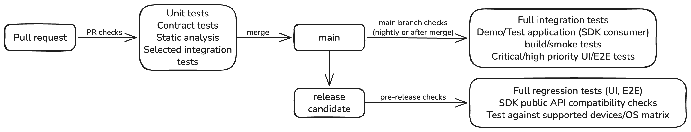

# Test Strategy and Assignment Exercises

## 1. Test Strategy

**Overall approach**

The test distribution should form a healthy **testing pyramid**, with a broad base of fast, isolated unit tests, fewer integration tests, and a limited number of slower system and end-to-end tests. The distribution should be risk-based rather than follow rigid percentages.

### Test levels

- **Individual SDK modules - Unit tests.** Verify business logic, state transitions, edge cases, error handling, and other module-specific functionality in isolation. Mock or stub external dependencies where appropriate.

- **Interfaces and contracts - Unit tests, contract tests, and static compatibility checks.** Verify that SDK interfaces behave according to their expected contracts, whether those contracts are formally defined as separate artifacts or represented by public interfaces and documented behavior. Use static API compatibility checks to detect breaking changes in exposed public SDK interfaces between versions. Include consumer compatibility tests where source or binary backward compatibility is required.

- **Module integrations - Integration tests.** Verify interactions between real SDK modules and their boundaries, as well as integration with the application's logic layer and view models. External dependencies can be stubbed where appropriate, but actual module interactions should be exercised rather than excessively mocked.

- **New application - Unit, integration, and system tests.** Unit-test application-specific logic, verify integration between the application and SDK modules, and perform system/UI tests using controlled or stubbed backend behavior. Include a limited number of tests against a real backend test environment to validate actual integration.

- **Consuming iOS and Android applications - Integration, compatibility, and acceptance tests.** Verify that the SDK can be integrated and used correctly by consuming applications. Include build and initialization smoke tests against the actual distributed SDK artifacts, compatibility tests across SDK versions, and a focused set of end-to-end/black-box tests for features involving SDK interactions.

### What I would automate

Automate as much as provides reliable value, prioritizing repeatable, high-risk, and frequently executed scenarios.

Automated tests should be deterministic and isolated wherever possible: use mocks/stubs or controlled test environments, avoid shared mutable state between tests, and manage test data explicitly.

Tests that are flaky or difficult to make deterministic should be investigated and redesigned where practical, rather than automatically moved to exploratory testing. Avoid excessive mocking where it could hide integration problems.

### Native vs. cross-platform testing

For SDK-level testing, I prefer **native testing frameworks** (XCTest/Swift Testing for iOS, JUnit/Kotlin-based tooling for Android). They provide direct access to platform-specific APIs, native behavior, lifecycle events, and diagnostics. This is especially important for SDK modules using low-level platform APIs.

Cross-platform black-box tools such as Maestro or Appium are justified for a small set of critical user journeys in the new application and consuming applications, particularly where behavior should be consistent across iOS and Android.

The goal is to keep most tests close to the implementation and use cross-platform tests selectively, avoiding duplication and unnecessary maintenance costs.

### What stays exploratory

Exploratory testing should focus on scenarios where human observation, investigation, or unusual environmental conditions provide additional value:

- **OS betas and new device classes:** Unexpected platform behavior and compatibility issues.
- **Interruptions and lifecycle scenarios:** Backgrounding, incoming calls, low-memory conditions, switching between Wi-Fi and cellular, and unusual sequences of events.
- **Upgrade paths:** Especially data written by an older SDK version and read by a newer one.
- **Accessibility and usability:** Manual VoiceOver/TalkBack testing, navigation, visual behavior, and overall user experience.
- **Developer experience:** Integrating an SDK module into a blank application using only its public documentation.

Exploratory testing complements rather than replaces automation. Important regression scenarios, such as common upgrade paths, lifecycle transitions, and accessibility checks, should also be automated where practical.

### Fast feedback and maintainability

I would organize automated tests into CI stages to balance coverage and execution time:

- **Pull requests:** Unit tests, contract tests, static analysis, and selected integration tests (with additional effort, a change-driven test suite can be implemented when the test run time grows).
- **Main branch:** Full integration tests, SDK consumer (a Demo/Test application) build/smoke tests, and critical application UI tests.
- **Nightly / pre-release:** Broader end-to-end and regression tests, SDK public API compatibility checks, real backend integration, SDK upgrade scenarios, and tests across supported OS versions and device configurations.

To keep the suite maintainable, I would:

- Use shared test fixtures, reusable mocks/stubs, and consistent testing conventions.
- Keep tests independent, with controlled test data and clear ownership.
- Minimize duplicated coverage across different test levels.
- Regularly review flaky, slow, redundant, and low-value tests.
- Maintain the Demo/Test application to continuously validate SDK integration.

The overall goal is **fast feedback during development, reliable regression detection, and sufficient confidence in SDK compatibility and application behavior without making the test suite expensive or difficult to maintain.**

## 2. Automation example

As an automation example, I chose the SDK's networking and error handling capability. The example demonstrates contract-level testing on both iOS and Android, using native testing frameworks: XCTest (Swift) and JUnit with Kotlin coroutine testing. For this *illustrative* example, I assumed that the SDK exposes `getOtpCode()` function, which makes a backend request and returns a six-digit OTP as a `String` on success. The SDK translates HTTP/transport failures into documented public SDK errors. This example is intentionally **not a standalone runnable project**. The SDK interfaces and models are illustrative. The code example is available in the [`/test-examples`](../test-examples/) folder, this folder also contains a [`README.md`](../test-examples/README.md) file with more details.

The automated scenarios cover:
- Successful OTP retrieval (HTTP 200), including validation of the returned code.
- Unauthorized requests (HTTP 401).
- Rate limiting (HTTP 429).
- Network timeouts and their mapping to SDK-specific errors.

Both platforms validate the same behavioral contract using equivalent scenarios and assertions, helping detect inconsistencies between iOS and Android implementations.

Key design decisions:
- Public API testing: Validate externally observable SDK behavior rather than internal implementation details.
- Deterministic execution: Stub network responses to eliminate external dependencies and keep tests fast and repeatable.
- Native frameworks: Use platform-specific testing tools for better integration, diagnostics, and maintainability.
- CI integration: Run these tests on every pull request to provide early feedback about regressions.

## 3. CI/CD and release validation

I assume the iOS and Android SDKs live in separate repositories. Each repository runs the same three stages shown above with its own native tooling. Example GitHub Actions workflows for both repositories are available in the [`/workflow-examples`](../workflow-examples/) folder.

### Checks and quality gates

| Stage | Checks | Quality gate |
| --- | --- | --- |
| **Pull request** | Static analysis, unit tests, contract tests, selected integration tests | All checks are required to merge, with a feedback target of about 15 minutes. No automatic retries: tests at this level must be deterministic. |
| **Main branch** (after merge and nightly) | Full integration tests, Demo/Test application build and smoke tests against the packaged SDK artifact, critical UI/E2E tests | A red main branch stops the line: the owning team fixes or reverts the change the same day. A release candidate cannot be cut from a red commit. |
| **Release candidate** | Full regression (UI, E2E), limited real-backend integration, upgrade scenarios, public API compatibility check, supported device/OS matrix, consumer application smoke tests | Every check blocks the release. A breaking public API change is accepted only with a major version bump and migration notes. Publishing the final version requires a manual go/no-go approval. |

### Slow and unstable tests

- **Slow tests** move to a later stage instead of running on every pull request. Each job has a time budget enforced by a timeout, suites run in parallel, and dependencies are cached. If pull-request time still exceeds the budget, I would add change-based test selection.
- **Unstable tests** are not hidden by blind re-runs. Critical UI/E2E tests get at most one automatic retry on main and release-candidate runs, and a test that passes only on retry is reported as flaky rather than green. A confirmed flaky test moves to a quarantine suite with an owner, a ticket, and an expiry date. Quarantined tests still run and report, but do not block. The quarantine list is reviewed before every release so that coverage is not lost silently.

### Communicating failures

- **Pull request:** a failed status check with a summary of the failing tests and links to logs, result bundles, and screenshots. The author owns the fix.
- **Main branch:** a message in the team channel naming the failed stage, the commit, and the owning module team, plus one tracked issue per failure instead of repeated alerts.
- **Release candidate:** a release report with gate results, public API changes, device matrix results, and quarantined tests, shared with consuming application teams.

Every failure message should answer three questions: what failed, who owns it, and how to reproduce it locally.

### Compatibility validation

| Dimension | How I would validate it |
| --- | --- |
| **SDK versions** | Semantic versioning, enforced by a public API diff against the last released version (`swift package diagnose-api-breaking-changes` on iOS, Kotlin Binary Compatibility Validator on Android). Upgrade tests where data written by the previous version is read by the new one. |
| **Module dependencies** | Locked dependency graphs (`Package.resolved`, `Podfile.lock`, Gradle dependency locking), so builds are reproducible and transitive changes are visible in review. When a module is upgraded, CI also runs the integration tests of the modules that depend on it, not only its own tests. |
| **iOS and Android implementations** | One platform-neutral contract specification (a scenario table like the one in the automation example) is the shared source of truth, versioned and pinned by both repositories. Each platform implements the scenarios as native contract tests, and each pipeline checks that every scenario in the pinned specification has a test. |
| **Consuming applications** | The Demo/Test application is built against the distributed artifact (Swift package or XCFramework, Maven artifact), not against source. Release candidates are published as pre-release versions (for example `3.5.0-rc.1`), so the new application and other consuming applications can run build and smoke tests against them before the final release. A compatibility matrix (SDK version, module versions, minimum OS, toolchain) is published with each release. |

## 4. Investigation scenario

**Starting point.** The pattern (intermittent, iOS only, only with both modules, first seen with 3.5) suggests an interaction problem: shared state or an initialization-order race between the two modules, or a transitive dependency that resolves differently when both are present. These are hypotheses to test, not conclusions. A green Android build does not clear the product either: I would first check that Android has an equivalent combined-module test at all.

**1. Observe and report.** Stop accepting a re-run as a pass. Record every occurrence, and treat 3.5 as not release-ready on iOS until the cause is understood.

**2. Reproduce and measure.** Run the failing test repeatedly on both versions, to get a failure rate for 3.4 and for 3.5. This confirms whether 3.5 really introduced the failure.

**3. Isolate by changing one variable at a time.**

- **Module version:** 3.4 vs. 3.5 with the other module fixed, then bisect the commits between them and compare `Package.resolved` (or `Podfile.lock`) for transitive changes.
- **Combination:** each module alone and both together in a minimal host app that only initializes them. This is the reproducer that neither module team has today.
- **Order and parallelism:** the test alone vs. in the full suite, fixed vs. randomized order, parallel execution on and off.
- **Environment:** CI vs. local, simulator vs. real device, Xcode and iOS versions, clean vs. reused simulator, runner load.
- **Timing:** Thread Sanitizer and injected delays to widen a suspected race window.

**4. Classify the cause.**

| Cause | Evidence that points to it |
| --- | --- |
| **Product** | Reproduces in the minimal host app outside the test suite; Thread Sanitizer reports a data race; the bisect lands on a 3.5 code change. |
| **Dependency** | The resolved dependency graph differs between 3.4 and 3.5, or between single-module and combined builds; pinning the previous transitive version removes the failure. |
| **Test** | Fails only in a certain order or in parallel and passes in isolation; depends on sleeps, shared fixtures, or state left by another test; also fails on 3.4 when that order is forced. |
| **Environment** | Limited to one runner image, Xcode version, or simulator runtime; correlates with runner load; started with an infrastructure change rather than with the upgrade. |

**Diagnostics.** CI should attach these to every failure automatically: the `.xcresult` bundle, unified logs tagged per module subsystem, crash reports, sanitizer output, the executed test order, resolved dependency versions, and the toolchain and runner image. Pass/fail history per test shows when the failure first appeared and how often it occurs.

**Prevention.**

- Add integration tests for module combinations to the main-branch suite.
- On a module upgrade, run the integration tests of dependent modules and flag unexpected changes in the dependency graph.
- Report "passed on retry" as flaky, not as green.
- Keep combined-module scenarios equivalent on iOS and Android.
- Share the root-cause analysis with both module teams and turn the finding into a guideline (for example, no shared global state without an owner).

## 5. Initial priorities

**1. Build a shared baseline of risk and coverage**

- **Why it matters:** Without knowing where regressions come from and what the existing automation already covers, any strategy would be guesswork and could duplicate or discard work that teams rely on.
- **Information needed:** Module inventory, owners, and dependency graph; existing tests per level and platform; CI duration and failure history; recent escaped defects and late integration issues; SDK versions used by consuming applications.
- **Who to involve:** Module team leads, iOS and Android engineers, consuming application teams, and the product or release owner.
- **First useful outcome:** A one-page map of modules, test levels, and platforms that shows the main gaps and risks, agreed with the module teams.

**2. Make the CI signal fast and trustworthy**

- **Why it matters:** Slow and unreliable tests teach developers to ignore red builds, and every later improvement depends on a signal that people trust.
- **Information needed:** Pass-rate history per test, pipeline durations, how often jobs are re-run, and which checks are currently required to merge.
- **Who to involve:** Module developers, CI/platform engineers, and team leads to agree on the policy.
- **First useful outcome:** An agreed set of required pull-request checks with a time budget in both repositories, and a quarantine process with owners for the most unstable tests.

**3. Protect consumers at module boundaries**

- **Why it matters:** The most expensive problems in the current setup are regressions in consuming applications, inconsistent iOS and Android behavior, and unclear version compatibility.
- **Information needed:** The public API surface, the versioning and distribution model, the supported OS range, and known behavior differences between platforms.
- **Who to involve:** Module owners, consuming application teams, architects, and release management.
- **First useful outcome:** A pilot on one high-risk module: a public API compatibility check, a shared contract scenario table implemented natively on both platforms, a Demo/Test application smoke test against the release candidate, and a first version of the compatibility matrix.

These three outcomes are also the input for the written platform-level QA strategy, which I would rather derive from evidence than write on day one.

**What I would postpone:** expanding the end-to-end suite, a full device-farm matrix, and change-based test selection. They are valuable, but only after the signal is trusted and the module boundaries are protected.

## 6. Risks and trade-offs

### Key assumptions

- The iOS and Android SDKs are native codebases in separate repositories with independent pipelines and releases.
- Modules are distributed as versioned artifacts (Swift packages or XCFrameworks, Maven artifacts) and follow semantic versioning.
- Module teams own their module-level tests; platform QA owns the strategy, shared tooling, and the cross-module and consumer-level checks.
- A Demo/Test application exists or can be created as a reference SDK consumer, and a backend test environment is available.
- The tools named in this document are examples, not prescriptions.

### Trade-offs

| Decision | Benefit | Risk or cost | Mitigation |
| --- | --- | --- | --- |
| Rely on unit, contract, and integration tests more than on end-to-end tests | Fast, stable feedback that points to the failing module | Problems that appear only with the real backend, real devices, or the packaged artifact can be missed | A small real-backend suite, Demo/Test application smoke tests against the distributed artifact, and a review of escaped defects to adjust the balance |
| Native test frameworks on each platform | Direct platform access and better diagnostics | Two test codebases; scenarios can drift apart between iOS and Android | A shared contract specification and scenario coverage checks |
| Stub the network boundary | Deterministic, fast tests | Stubs can drift from real backend behavior | Stub only external boundaries, validate fixtures against the backend API specification, and keep limited real-backend tests |
| Run slow tests after merge or before release | Short pull-request feedback | Some defects are found later, when attribution is harder | Run main-branch checks after every merge, and move tests that catch regressions to an earlier stage |
| Quarantine unstable tests | The blocking signal stays trusted | Quarantine becomes permanent and coverage is lost | An owner, a ticket, and an expiry date for each test, with a review before every release |
| Public API compatibility checks | Consumers are protected from accidental breaking changes | Only signature changes are detected, not behavior changes | Contract tests for behavior and a clear deprecation policy |
| Device/OS matrix only before release | Lower CI cost | Device-specific issues are found late | A risk-based matrix (minimum, latest, and most-used OS versions), with a configuration moved to the nightly run if it produces defects |

The approach also depends on module teams accepting shared gates and ownership of their tests. I would reduce this adoption risk by starting with a pilot on one module and using its results to agree on the wider rollout.

